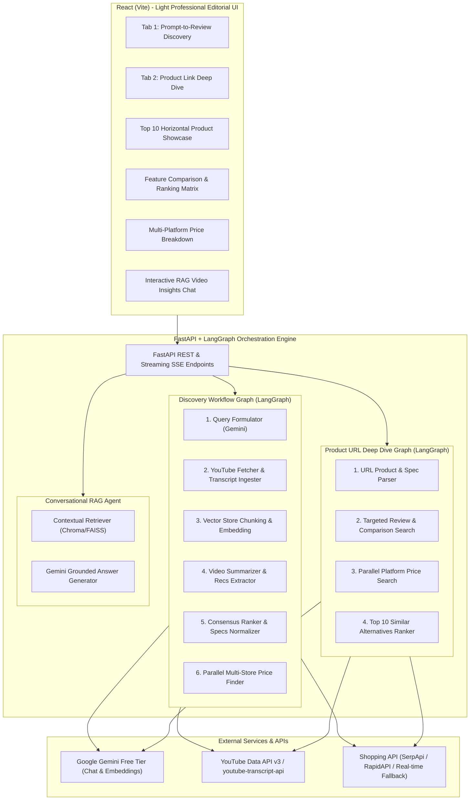

# Implementation Plan: GenAI Product Review & Price Comparison Platform

An editorial-grade, light-themed product review and multi-platform price comparison platform powered by **LangGraph**, **LangChain**, **Google Gemini API**, and **React**.

---

## 1. System Architecture Overview

---

## 2. Key Modules & Technology Stack

### Backend Stack
- **Framework**: Python 3.10+ with `FastAPI` and `uvicorn`.
- **Agent Orchestrator**: `LangGraph` (StateGraph) for cyclical, branched, and parallel workflows.
- **LLM & Embeddings**: `langchain-google-genai` using Google Gemini (e.g. `gemini-1.5-flash` or `gemini-2.0-flash` on the free tier) and `GoogleGenerativeAIEmbeddings` (with a local `fastembed` / HuggingFace fallback if quota applies).
- **Vector Store**: `Chroma` (or `FAISS`) in-memory or persisted per session.
- **YouTube Ingestion**:
  - `google-api-python-client` (YouTube Data API v3) for top video retrieval.
  - `youtube-transcript-api` and `yt-dlp` for direct subtitle extraction without burning high video quota.
  - LangChain `RecursiveCharacterTextSplitter` (chunk size ~1000, overlap ~150).
- **Price Discovery Service**:
  - SerpApi Google Shopping free tier / RapidAPI Real-Time Product Search.
  - Resilient mock/fallback provider simulating real-time merchant pricing (Amazon, Best Buy, Walmart, B&H, Newegg, Target) to guarantee smooth execution even without external paid rate limits.

### Frontend Stack
- **Framework**: React 18 / 19 with Vite.
- **Styling**: Vanilla CSS with modern CSS custom properties (design tokens).
- **Aesthetic**:
  - Clean editorial aesthetic inspired by *Wirecutter*, *RTINGS*, and *The Verge*.
  - **Light Theme**: Crisp porcelain background (`#f8fafc` / `#ffffff`), deep charcoal typography (`#0f172a`), subtle slate borders (`#e2e8f0`), and refined accent blues/indigos (`#2563eb`).
  - No generic dark neon AI gradients. Focus on typography, spacious cards, comparison badges, spec grids, and interactive price pills.
- **Components**:
  1. **Prompt Search Bar & Quick Suggestion Chips**.
  2. **Top 10 Horizontal Product Carousel**: Cards with lowest price badge, top pros/cons, consensus score.
  3. **Feature Comparison Table**: Dynamic column matrix highlighting best battery life, performance, display, value score.
  4. **Multi-Store Price Comparison**: Expandable merchant breakdown per product with direct price tags.
  5. **Reviewer Consensus Summary Drawer**: Video-by-video breakdown (video thumbnail, reviewer verdict, ranked position).
  6. **RAG Chatbot Drawer / Tab**: Grounded chat with source citation badges linking back to timestamped video snippets.
  7. **Tab 2: Paste Product Link**: Analyzes pasted product, scrapes/infers product info, retrieves top YouTube reviews, compares prices, and ranks the top 10 competitors in that price range.

---

## 3. LangGraph Workflow Specifications

### Workflow A: Prompt-Based Product Discovery (`DiscoveryGraph`)

1. **State Definition (`DiscoveryState`)**:
   - `prompt`: str
   - `search_query`: str (e.g., "Top 10 wireless noise cancelling headphones in 2026")
   - `videos`: List[VideoMetadata] (Title, URL, Channel, Thumbnail, Transcript)
   - `video_summaries`: List[VideoSummary] (Pros, Cons, Rankings, Verdict)
   - `extracted_products`: List[ProductMention] (Name, Specs, Rank, MentionsCount)
   - `ranked_products`: List[RankedProduct] (Top 10 consensus list, common specs matrix)
   - `product_prices`: Dict[str, List[MerchantPrice]] (Amazon, Walmart, Best Buy, etc.)
   - `vector_store_id`: str (ID for session vector store)

2. **Step-by-step Nodes**:
   - **`formulate_query`**: Formulates search query targeting tech review roundups for the current year.
   - **`fetch_youtube`**: Calls YouTube search to retrieve top 5 relevant review videos and extracts transcript text.
   - **`index_transcripts`**: Splits transcripts into chunks and upserts to Chroma vector store.
   - **`extract_and_summarize`**: Structured LLM prompt extracts each video's specific recommendations, ordinal ranks, and key specs.
   - **`rank_and_matrix`**: Cross-video consensus aggregator calculates frequency, computes top 10 products, and standardizes key comparison specs (e.g. Battery, Weight, Connectivity, Warranty).
   - **`fetch_prices`**: Async parallel tasks query shopping endpoints for each of the 10 products to fetch live platform prices and find the lowest price.

---

### Workflow B: Product Link & Competitor Ranking (`LinkAnalysisGraph`)

1. **State Definition (`LinkAnalysisState`)**:
   - `url`: str
   - `detected_product`: ProductInfo (Brand, Name, Model, Category, Target Price)
   - `videos`: List[VideoMetadata] (Review & comparison videos for this specific model)
   - `platform_prices`: List[MerchantPrice] (Current product price across stores)
   - `competitors`: List[RankedProduct] (Top 10 similar products in this category/price bracket)
   - `feature_matrix`: List[ComparisonRow]

2. **Step-by-step Nodes**:
   - **`parse_product_url`**: Extracts title/metadata from URL or infers using Gemini.
   - **`fetch_product_reviews`**: Searches YouTube specifically for reviews and head-to-head comparisons of this item.
   - **`index_reviews`**: Stores chunks in session vector store for QA.
   - **`find_prices`**: Gathers merchant pricing for the target item.
   - **`discover_competitors`**: Identifies the top 10 alternatives in the same category/bracket with comparative scoring.

---

### Workflow C: Session RAG Chatbot

- **Query Analyzer**: Rewrites user query into standalone search query.
- **Retriever**: Queries the session vector store (retrieves top 4-6 transcript chunks with timestamps & video titles).
- **Grounded Answer Generator**: Gemini synthesizes answer with inline citations (e.g. `[MKBHD]`, `[Linus Tech Tips]`).

---

## 4. Implementation Phases & Milestones

### Phase 1: Backend Foundation & API Connectors
1. Set up Python virtual environment with dependencies:
   - `fastapi`, `uvicorn`, `langgraph`, `langchain`, `langchain-google-genai`, `chromadb`, `youtube-transcript-api`, `pydantic`, `httpx`.
2. Implement **YouTube Service**:
   - Search integration via YouTube Data API v3 with automatic fallback to `youtube-transcript-api` and video scraping.
3. Implement **Price Comparison Service**:
   - Integration with Google Shopping / RapidAPI and mock price generator fallback for instant resilience.
4. Setup **Vector Store Manager**:
   - Chroma in-memory/persistent store per session with Google GenAI Embeddings.

### Phase 2: LangGraph Workflows Implementation
1. Construct `DiscoveryGraph`:
   - Query formulation prompt -> YouTube transcript extraction -> Vector store ingestion -> Structured JSON product synthesis -> Parallel price resolution.
2. Construct `LinkAnalysisGraph`:
   - URL parsing -> Review ingestion -> Price discovery -> Competitor matrix generation.
3. Construct `RAGChatGraph`:
   - Grounded conversational QA endpoint streaming back answers with source citations.
4. Expose FastAPI REST endpoints:
   - `POST /api/discovery`: Start prompt discovery workflow.
   - `POST /api/analyze-link`: Start link analysis workflow.
   - `POST /api/chat`: Grounded RAG chat endpoint.
   - `GET /api/health`: Health check and API key validation.

### Phase 3: Frontend Implementation (React + Vite)
1. Initialize Vite React application with clean modular structure:
   - `src/components/Header.jsx`: Minimalist navigation, tab switcher (Prompt Discovery vs. Link Analyzer), API key setup status.
   - `src/components/SearchHero.jsx`: Prompts, category quick filters ("Headphones", "Laptops", "Coffee Makers", "Cameras").
   - `src/components/ProductCarousel.jsx`: Horizontal scrollable top 10 card deck with store badges, prices, and specs.
   - `src/components/ComparisonMatrix.jsx`: Feature-by-feature interactive ranking table with highlight filters.
   - `src/components/PriceBreakdownModal.jsx`: Multi-store price comparison view with direct platform links.
   - `src/components/VideoInsights.jsx`: Collapsible cards displaying the 5 reviewed videos and their verdicts.
   - `src/components/RagChatWidget.jsx`: Interactive chatbot sidebar/modal connected to the transcript vector store.
   - `src/components/LinkAnalyzerTab.jsx`: Paste product URL, displays direct price comparison & top 10 similar alternatives.
2. Design & Styling (`index.css`):
   - Crisp editorial light theme: slate/white card surfaces, subtle borders, high-contrast readable typography, soft shadows, responsive grids.

### Phase 4: Integration, Testing & Polish
1. Test end-to-end flow with sample prompts (e.g. "Best wireless earbuds under $150").
2. Validate Gemini free tier token limits and implement retry/caching to avoid rate limits.
3. Test link analysis with real product URLs (Amazon, Best Buy, etc.).
4. Verify RAG chat accuracy and citation links.
5. Provide a convenient one-command launcher (`run.ps1` or `start.bat`) and comprehensive documentation.
